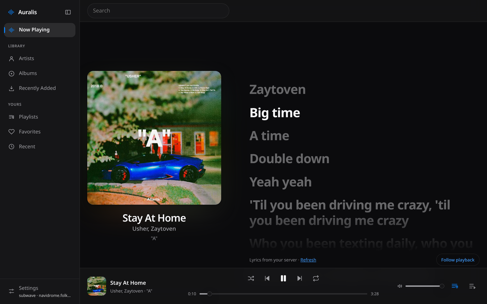
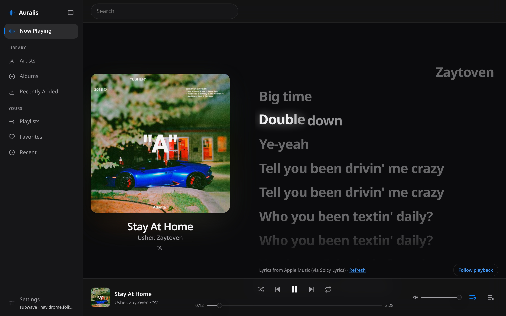
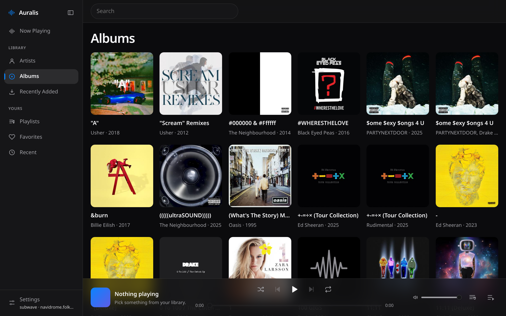

# Auralis

A modern client for [Navidrome](https://www.navidrome.org/) and any other Subsonic/OpenSubsonic server, with an
Apple-inspired Liquid Glass interface and word-by-word synced lyrics.

## Features

- **Library** — artists, albums, recently added and recently played, search, and artwork-driven *Album Artwork* theme
  alongside several fixed themes.
- **Playback** — persistent player with a queue (play next, add, shuffle, repeat), media-key and lock-screen controls,
  and play reporting back to your server.
- **Your server stays the source of truth** — favourites and playlists are stored on the server and show up in your
  other Subsonic clients.
- **Audio effects** — on Now Playing: playback speed (pitch kept), pitch (tempo kept), reverb and a 10-band equalizer,
  with a bypass that keeps your settings. Pitch, reverb and the equalizer need CORS on the server's audio (like karaoke);
  pitch also needs HTTPS or localhost. Speed works everywhere.
- **Social** — top-left in the app: who on your server is playing what (with one-tap play), and people/profiles built only from
  that data. Sharing your own listening is **off** until you turn it on. No Subsonic server has friends or messages, so
  Auralis doesn't fake them.
- **Lyrics** — server lyrics first, [LRCLIB](https://lrclib.net) as fallback, and optional syllable-level lyrics from
  Spicy Lyrics (the active syllable lifts and glows as it is sung).

## Screenshots



Word-by-word lyrics from Spicy Lyrics: the syllable being sung lifts and glows.





## Platforms

| Platform | Technology | Where |
|---|---|---|
| Browser | React + Vite | `web/` |
| Linux, Windows | Tauri 2 desktop shell | `tauri/` |
| Android | Tauri 2 mobile shell with its own phone UI | `android/` |
| macOS 26+ | Native SwiftUI | `macos/` |
| iOS 26+ | Native SwiftUI | `ios/` |
| Shared code | Web app core (`shared/ui`), Apple Swift package and SwiftUI (`shared/apple`) | `shared/` |
| Lyrics backend | Node, no dependencies, Docker image | `server/`, `Dockerfile` |

Each platform folder builds on its own; what they share, and the rules that keep them apart, are in
[`docs/STRUCTURE.md`](docs/STRUCTURE.md).

Tagged releases (`v*`) build a portable Windows exe and a signed Android APK in CI. What is verified on each platform is
tracked honestly in [`docs/PLATFORMS.md`](docs/PLATFORMS.md).

## Documentation

| Doc | What is in it |
|---|---|
| [`PLAN.md`](PLAN.md), [`TASKS.md`](TASKS.md) | Scope and status |
| [`ARCHITECTURE.md`](ARCHITECTURE.md), [`DESIGN.md`](DESIGN.md) | How the app is built and styled |
| [`API.md`](API.md) | Subsonic usage and the lyrics backend API |
| [`TESTING.md`](TESTING.md) | Test strategy and the browser-test setup |
| [`docs/STRUCTURE.md`](docs/STRUCTURE.md) | Repository layout, what is shared, dependency rules, how to build each platform |
| [`docs/`](docs) | Apple, desktop, backend and platform status |

## Run it

Requires Node 20.12+ (developed on Node 24). Docker is optional and only runs the lyrics backend (`docker compose up -d`).

```sh
npm install
cp .env.example .env     # optional: only needed for Spicy Lyrics (see below); .env is git-ignored
npm run dev              # web app on http://localhost:5173 (also serves /api/spicy/*)
npm run build            # production web bundle in web/dist/
npm start                # production server: web/dist/ + /api/spicy/* on http://127.0.0.1:8787
```

Connect with your server address, username and password. Requirements on the server side:

- **CORS** must allow the origin Auralis is served from (Navidrome allows `*` by default; a reverse proxy that also adds `Access-Control-Allow-Origin` can break this).
- If Auralis is served over **HTTPS**, the server must be HTTPS too (mixed content is blocked).
- For the *Album Artwork* theme, cover-art responses need CORS headers as well (the browser refuses to read pixels otherwise; the default palette is used instead).

## Around the library

- **Favourites** — the heart on any track, album or artist stars it on your server; the **Favorites** page is the same
  list your other Subsonic clients see.
- **Track actions** — the "More" button on a track row opens play next, add to queue, add to playlist, favourite,
  go to album/artist, and (inside a playlist) remove from it.
- **Playlists** — add a track to an existing playlist or create one from a track. Playlists live on the server.
- **Play reporting** — Auralis tells your server what is playing and records the play once you have heard half of it
  (or four minutes). This is what keeps Navidrome's play counts, its *recently played* list — which is what the
  **Recent** page shows — and smart playlists accurate. Turn it off in Settings → Playback. Nothing is sent anywhere
  but your own server.
- **Navigation** — the sidebar collapses to an icon rail (the choice is remembered), `/` focuses search, and on a phone
  it becomes a tab strip above the content.

## Spicy Lyrics (word-synced lyrics) — backend setup

[Spicy Lyrics](https://developers.spicylyrics.org/docs) provides syllable-level synced lyrics. Its API needs a **secret key that must never reach the browser**, so Auralis calls it through a tiny backend (`server/spicy.mjs`) on the same origin as the app:

```
browser ──GET /api/spicy/lyrics/<spotify track id>──▶ Auralis backend ──Bearer key──▶ api.spicylyrics.org
```

**Local**

1. Create an application at https://developers.spicylyrics.org/dashboard and copy its secret key (shown once).
2. Put it in `.env` (git-ignored): `SPICY_LYRICS_SECRET_KEY=…` — **no `VITE_` prefix**, so Vite never exposes it.
3. `npm run dev`. The Vite dev and preview servers mount the same handler, so there is no second process. Settings → Lyrics shows "Ready" when the key is picked up.

**Production**

Run one Node process that serves both the app and the API:

```sh
npm ci && npm run build
SPICY_LYRICS_SECRET_KEY=… HOST=0.0.0.0 PORT=8787 npm start     # or put the variables in the service's environment
```

Put it behind your HTTPS reverse proxy, e.g. nginx:

```nginx
location / { proxy_pass http://127.0.0.1:8787; proxy_set_header Host $host; proxy_set_header X-Forwarded-Proto $scheme; proxy_set_header X-Forwarded-For $remote_addr; }
```

Then set `TRUST_PROXY=1` (so rate limiting sees real client addresses; only behind a proxy you control). If you serve the static files from somewhere else (CDN, Netlify, …), route `/api/spicy/*` to this Node process on the **same origin**; without a backend the feature is simply skipped and lyrics fall back to Navidrome/LRCLIB. Store the key in your host's secret store, never in the repo or the image. Optional variables are listed in `.env.example`.

**Automatic matching (recommended).** Spicy Lyrics is addressed by Spotify track id, which a Navidrome library does not have. With Spotify credentials configured, the backend finds the id for each track by searching Spotify (by ISRC when your files are tagged with one, else title + artist) and Auralis accepts it only when it is clearly the same recording: same title and artist, duration within a few seconds, and not a live/remix/acoustic/edit/re-recorded variant. When two different recordings fit equally, Now Playing asks you to pick one instead of guessing; when nothing fits, lyrics come from Navidrome/LRCLIB as before. Rules and thresholds: `API.md` §6c.

1. Create an app at https://developer.spotify.com/dashboard (any name; tick *Web API*; the redirect URI is unused, e.g. `http://127.0.0.1/`).
2. Copy its **Client ID** and **Client secret** into `.env` (or the service environment): `SPOTIFY_CLIENT_ID=…`, `SPOTIFY_CLIENT_SECRET=…`. No user login is involved (Client Credentials flow).
3. Restart Auralis. Settings → Lyrics → *Automatic Spotify matching* shows "On".

Requirement you should know about: since February 2026 Spotify only serves Development Mode apps whose **owner has an active Spotify Premium subscription**; without it searches fail (logged once as a 403) and Auralis falls back to manual links and the other providers. There is no credential-free alternative: Spicy Lyrics has no metadata lookup and the song.link API no longer works without a key. The Spotify search quota is per developer account; Auralis caches matches (30 days in the browser, 24 h in the backend) and searches only when a track starts playing.

**Manual links and corrections.** On *Now Playing*, open "Word-synced lyrics (Spicy Lyrics)": it says whether the track was matched automatically (and to which recording), linked by you, has no match, or needs a choice. You can pick a recording, paste a Spotify link (it always wins), mark an automatic match as *Wrong recording*, or switch Spicy Lyrics off for one track. Choices are stored on this device per server, user and track. All of this follows the *External lookups* setting.

Security properties: the key exists only in the backend process (never in the bundle, `import.meta.env`, responses, or logs); the endpoint has three fixed GET routes, validates the id (22 base62 characters) and the match fields (title/artist/ISRC only, length-limited; the Spotify query is built server-side), forwards nothing from the client, refuses other sites (`Sec-Fetch-Site`/`Origin`), rate-limits per client, and caches in memory for 6 h. It is not authenticated: anyone who can reach your deployment can look up lyrics by Spotify id through your quota, so keep it private (VPN/auth proxy) if that matters. If the key leaks, rotate it in the dashboard (instant).

## Checks

```sh
npm test            # every workspace: shared/ui (Vitest, jsdom, MSW), server, android phone UI
npm run typecheck   # every workspace
npm run lint        # ESLint + the dependency-boundary check (docs/STRUCTURE.md)
npm run build       # the web bundle (build:tauri / build:android build the other platforms)
npm run test:e2e    # real-browser tests (Playwright): web, and the android phone UI, against a built app and a mock server
```

See `TESTING.md` §9 for the browser-test setup (including using a system Chromium) and what each suite covers.

## Verify against your own Navidrome

Automated tests never touch a real server. Before relying on a build, walk through this once:

1. `npm run dev`, connect with your real server. Check the Library loads and artwork appears.
2. Search for an artist, an album and a track.
3. Play an album: audio starts, seeking works, next/previous work, the queue panel reflects the order. Let a track end and check it advances.
4. Open **Now Playing** on a track that has lyrics in Navidrome: lines highlight in time and clicking a line seeks. Try a track without server lyrics (LRCLIB fallback, if *External lookups* is on).
   With Spicy Lyrics + Spotify configured: play a few well-known studio tracks (they should switch to word-by-word lyrics on their own), a live or remix track (it must *not* get the studio lyrics), and a song that exists on several albums (expect either a match or a short choice). Check that words light up with the vocals, seek back and forth, pause and resume.
5. Reload the page: you stay signed in only if you ticked *Remember this device*; the queue and position come back **paused** (browsers cannot resume audio by themselves).
6. Favourite a track, an album and an artist; check they appear under **Favorites** and in another client (or Navidrome's own web UI). Un-favourite one and check it disappears.
7. Add a track to a playlist and create a playlist from a track; check both in Navidrome. Remove a track from a playlist page.
8. Play a track past halfway, then check Navidrome's play count / *recently played* for it, and that the **Recent** page starts filling up. Turn off Settings → Playback → *Report plays to your server* and confirm nothing more is recorded.
9. In Settings: switch themes (including *Album Artwork*), try *Disconnect*, and confirm stored credentials are gone (DevTools → Application → IndexedDB → `auralis`).
10. Stop the server (or block it) while playing and while browsing: you should see a clear message with a retry, not a blank page.
11. Audio effects (listen; the automated test only measures a test tone): on Now Playing open *Audio effects*. Speed 1.5×
    should sound faster at the same pitch; pitch +5 should sound higher at the same tempo; Hall reverb at 50 % should
    add a tail you hear after pausing; *Effects* off must sound exactly like the original without the track restarting,
    and on again must bring every setting back. If your server lacks CORS, the panel must say so and only speed works.

## Security notes

- Requests use Subsonic **token auth** (`t = md5(password + salt)`, fresh salt per request); the password is never sent. Because `<audio>` and `` cannot add headers, stream and cover-art URLs carry `u`, `t` and `s` in the query string. They are not the password, but anyone who can read the URL (browser history, proxy/server logs) can reuse that token+salt pair against that server. Use HTTPS.
- *Remember this device* stores the **plaintext password** in IndexedDB (token auth needs it for every request). Leave it off on shared computers. Disconnect removes it.
- Nothing is sent to third parties except, when *External lookups* is on: the track title/artist/album/duration to `lrclib.net` if the server has no lyrics; the title, primary artist and ISRC to Spotify's search (via your own backend, only when Spotify credentials are configured); and the matched or linked Spotify track id to Spicy Lyrics (via your own backend).

## Other platforms

Web is the reference implementation. Native Apple apps (`macos/`, `ios/`), the Tauri desktop shell (`tauri/`), the Android app (`android/`) and the lyrics backend container are described, with honest verification status and a feature matrix, in [`docs/PLATFORMS.md`](docs/PLATFORMS.md), [`docs/APPLE.md`](docs/APPLE.md), [`docs/DESKTOP.md`](docs/DESKTOP.md) and [`docs/BACKEND.md`](docs/BACKEND.md).
